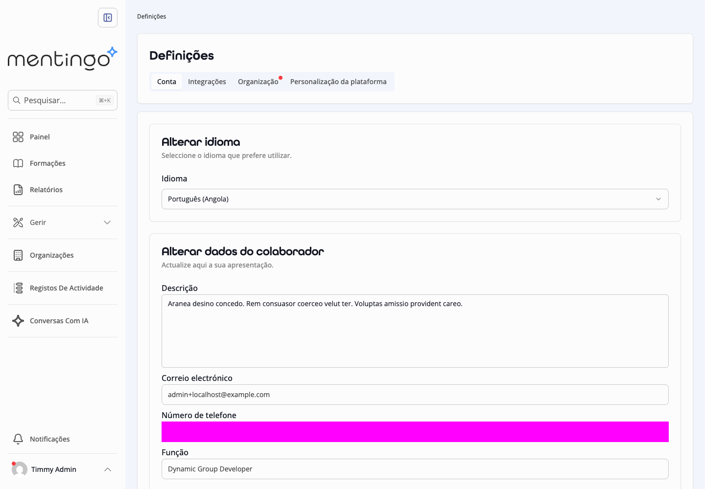
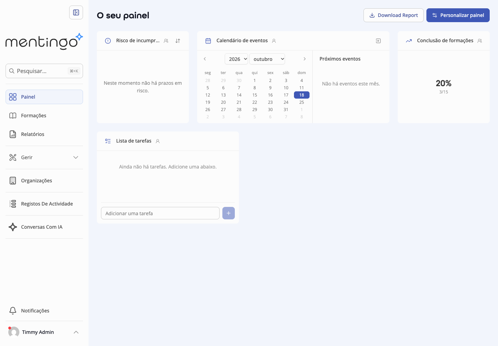

# QA visual — Chrome, 18-10-2026

Estado: **18 checkpoints automatizados passaram; verificação interactiva adicional pelo Chrome DevTools MCP executada**. Sem aprovação para produção.

Código ensaiado: checkpoint `3a6dc5e8`, com ampliação dos três scripts de QA nesta execução. API e frontend locais reais; dados exclusivamente fictícios. Aplicação: http://localhost:5173 ; API: http://localhost:3000 . O endereço localhost destina-se a este computador; não é uma publicação externa.

## Resultado observado

| Ensaio | Resultado | Evidência |
|---|---|---|
| Login, painel, selector EN→pt-AO, persistência, catálogo e lição | **7 checkpoints passaram**, processo terminou sem erro | `browser-smoke.mts`; capturas 01–04 |
| Texto/PDF privado, transferência interrompida/retry, reabertura sem rede e remoção | **6 checkpoints passaram**, processo terminou sem erro | `browser-offline.mts`; capturas 05 |
| Avaliação descarregada, resposta sem rede, reabertura, sincronização e conclusão nativa | **5 checkpoints passaram**, processo terminou sem erro | `browser-offline-assessment.mts`; capturas 06 |
| Chrome DevTools MCP | Login real, painel e catálogo observados; HTML `lang=pt-AO` confirmado; consola examinada | Captura 07 e observações abaixo |
| Catálogo, PDF e quiz a 390×844 | **0 px de overflow horizontal** nos três percursos ensaiados | Asserções de largura e capturas móveis |

Os checkpoints são verificações de percurso, não 18 suites unitárias distintas. A repetição do recibo da avaliação devolveu o mesmo identificador persistido e a conclusão da lição foi consultada no motor nativo. Não se simulou uma resposta de sucesso: apenas se interrompeu deliberadamente uma transferência de PDF para ensaiar falha/retry. A rede offline foi simulada pelo Chrome/Playwright.

Os testes API/SCORM/certificados e unitários anteriores permanecem nos relatórios 01–05; **não foram todos repetidos neste QA**. Não se alterou código da aplicação nesta execução, apenas scripts de QA e documentação.

## Galeria — capturas da aplicação real

### Login e preferência de idioma




A faixa magenta cobre intencionalmente o campo de telefone fictício na captura; não é um defeito da interface.

### Painel e catálogo



O indicador de 20% no painel pertence às conclusões dos dados fictícios de formação. **Não representa os 50% da sprint**.


### Lição e conteúdos sem rede


### Avaliação sem rede e sincronização real


## Achados e limitações

| Prioridade | Observação | Próxima acção |
|---|---|---|
| P2 | “Download Report” no painel, títulos de páginas/alguns controlos ainda em inglês | Completar chaves e metadados dos percursos principais; cobertura actual 34,01% |
| P2 | Login mostra `v0.0.0`, embora a base auditada seja v4.23.0 | Tornar a revisão demonstrada identificável no build local |
| P2 | PostHog sem token emite erro na consola local | Desactivar a inicialização quando não configurado; não inserir credenciais reais para esconder o aviso |
| P3 | Cursos de seed em inglês e biografia fictícia em latim | Preparar conteúdo de demonstração em pt-AO; conteúdo não é traduzido automaticamente pela interface |
| P3 | “Registos De Actividade”/“Conversas Com IA” com capitalização editorial a rever | Rever textos sem alterar identificadores técnicos |
| P3 | PDF móvel cabe no ecrã mas exige ampliação; ficheiro pequeno aparece como 0,00 MB e aviso genérico de formatos pode confundir | Melhorar escala/unidades e mensagem contextual |

Na sessão DevTools surgiram avisos React Router e PostHog, além de duas respostas 401 durante a navegação anterior à autenticação. O login e as leituras autenticadas seguintes funcionaram; o 401 anónimo não demonstra falha de autorização. Não se realizou uma análise completa de todas as chamadas de rede.

O primeiro registo do painel captou carregamento prematuramente; o script foi corrigido para esperar pelos widgets antes da captura final. Isto foi um problema de recolha de evidência, não um defeito funcional confirmado.

O Chrome DevTools MCP foi utilizado efectivamente, com contexto isolado `omatapalo-qa`. A exportação directa de screenshot para o worktree foi recusada pela política de caminhos do conector; a captura 07 foi obtida pelo mecanismo temporário padrão da própria ferramenta e copiada para esta galeria. As outras 12 capturas foram produzidas pelos scripts Playwright.

**Não demonstrado:** Android físico, acessibilidade WCAG integral, carga 20/50/100, consumo de dados sob throttling, vídeo/SCORM offline, player SCORM no navegador e ciclo visual completo de certificados. A emulação de largura móvel não substitui Android real. O precache do build anterior tem aproximadamente 14 MB, a considerar no ensaio de dados móveis.

## Reprodução

No worktree persistente do sprint, com os serviços e API/preview locais activos segundo os relatórios 01 e 05:

```sh
source scripts/sprints/omatapalo/environment.sh
export SPRINT_QA_OUTPUT="$PWD/.local/sprint/screenshots"
sprint_pnpm --filter api exec tsx --tsconfig ../web/tsconfig.json ../../scripts/sprints/omatapalo/browser-smoke.mts
sprint_pnpm --filter api exec tsx --tsconfig ../web/tsconfig.json ../../scripts/sprints/omatapalo/browser-offline.mts
sprint_pnpm --filter api exec tsx --tsconfig ../web/tsconfig.json ../../scripts/sprints/omatapalo/browser-offline-assessment.mts
```

Executar sequencialmente. Os scripts usam apenas as contas/base fictícias deste ambiente; não apontar para outro servidor. Os ensaios offline criam e removem entidades sintéticas. Logs locais: `.local/sprint/qa-visual-*-complete.log`. Resultados e hashes das capturas: [manifesto](qa/2026-10-18/manifest.json).

Tempo: os três processos concluíram nesta retoma e a verificação DevTools foi registada a partir de 01:22 UTC. Não existe medição exclusiva que permita atribuir horas individuais a cada melhoria de QA; não se inventou esse valor. Trabalho restante: resolver achados, validar Android real e completar os gates do relatório 11.
