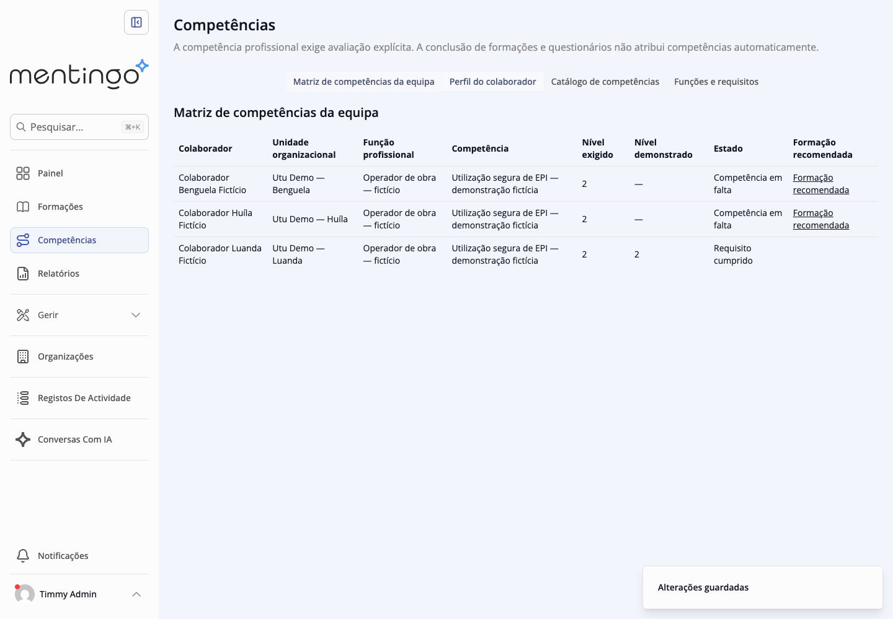
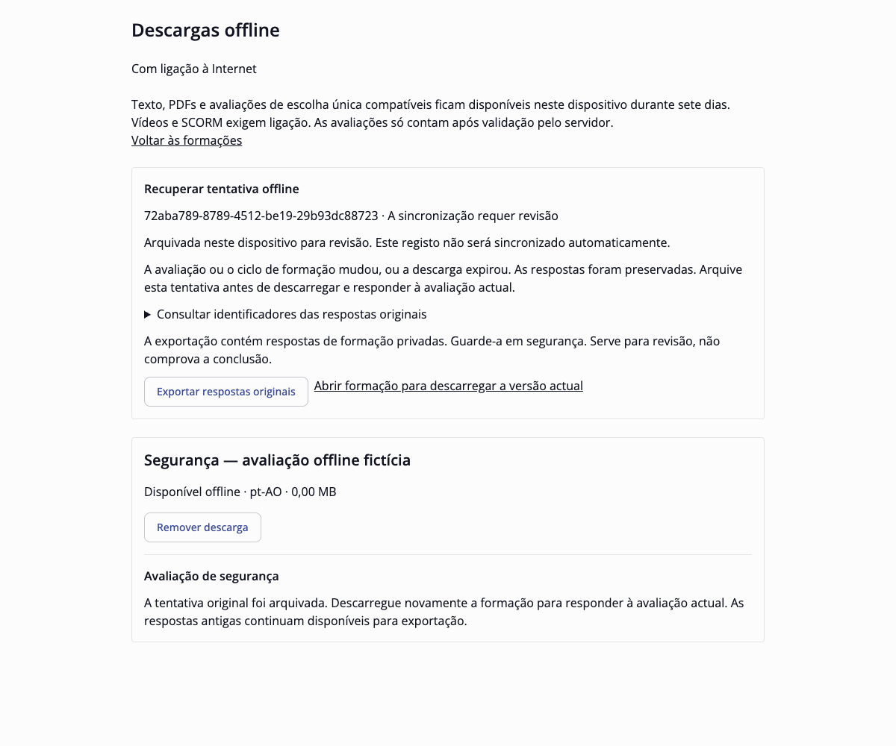
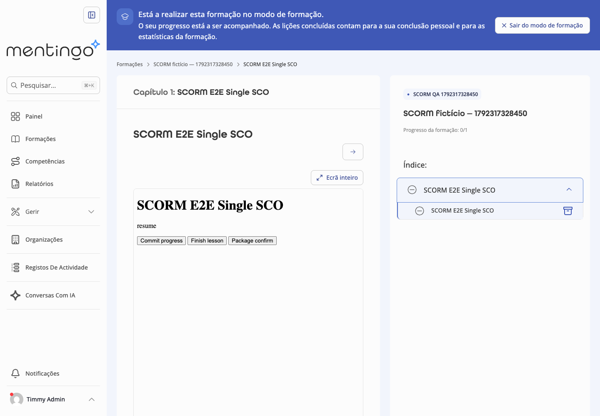

# QA visual — execução seguinte de 18-10-2026

Estado: **28 checkpoints Chrome passaram** em cinco percursos: competências 5, navegação/idioma 7, SCORM sintético 4 e recuperação offline 6+6. API, PostgreSQL, Redis e armazenamento privado locais reais; sem interceptar respostas para simular sucesso. Apenas dados fictícios. Commits de código: `ca797c72`, `067407d1`, `848677e0`, `94f14739`, `b414f7ba`, `906c9398`, `30ff88f2`.

As imagens foram abertas e inspeccionadas. O [manifesto](qa/2026-10-18-next/manifest.json) contém dimensões e SHA-256. São capturas de percursos automatizados no Chrome, complementados por inspecção interactiva no **Chrome DevTools MCP** da matriz pt-AO. Não constituem um ensaio num Android físico nem uma auditoria integral de acessibilidade.

## Competências

Catálogo e três níveis, requisitos por função, atribuições a Luanda/Huíla/Benguela, avaliação explícita e histórico. Luanda cumpre o nível 2; as outras unidades têm competência em falta. O perfil conserva as evidências anteriores. O percurso do administrador foi exercitado visualmente; gestor e formando têm autorização/âmbito cobertos pela API, sem nova demonstração visual específica de cada papel.

[Pormenor do histórico e formulário](qa/2026-10-18-next/08-competency-evidence.png) · [Viewport de 390 px](qa/2026-10-18-next/08-competency-mobile.png). A matriz permite deslocação horizontal interna no ecrã estreito; os controlos da página mantêm-se acessíveis. A captura do histórico é um pormenor da área deslocável, não o perfil inteiro.

## Recuperação offline

O HTTP 401 real conserva as respostas e permite repetir explicitamente após recuperar a sessão. No ensaio retiraram-se cookies e restaurou-se uma sessão válida; não se aguardou a expiração natural do JWT.

[Captura da recuperação da sessão](qa/2026-10-18-next/09-offline-session-recovery.png).

Uma alteração real da avaliação devolveu 409. As respostas originais foram exportadas e arquivadas por confirmação, a cópia antiga foi bloqueada e uma nova descarga permitiu uma tentativa separada. Fechar/reabrir o Chrome conservou as respostas. A repetição da sincronização devolveu o mesmo recibo e a conclusão foi confirmada no motor nativo.

## SCORM 1.2

O conteúdo do pacote está em inglês porque é o ZIP sintético MIT do upstream. A interface exterior está em pt-AO. O teste verificou importação pela UI, publicação, iframe, checkpoint, retoma, ecrã inteiro e conclusão. Usou administrador no modo de formando nativo. Não demonstra pacote independente, Android, SCORM 2004, xAPI ou offline SCORM. Curso/categoria do ensaio foram removidos pelo guião após a validação; a demonstração persistente de competências mantém-se.

## Reproduzir

Aplicação: http://localhost:5173 ; competências: http://localhost:5173/competencies . Usar a conta fictícia local do seed, sem contas de clientes. Os guiões estão em `scripts/sprints/omatapalo/browser-{competencies,smoke,scorm,offline-assessment}.mts` e são executados com o `environment.sh` do worktree. Os modos `SPRINT_TEST_AUTH_RECOVERY=1` e `SPRINT_TEST_ASSESSMENT_CHANGE=1` activam os dois casos de recuperação. Consultar [guião Android](13-android-physical-validation.md) para a validação física ainda pendente.

## Limitações observadas

Permanecem etiquetas de acessibilidade inglesas herdadas no logótipo/avatar e um título de separador que pode conservar inglês na primeira navegação. O catálogo completo não resolve textos fixos nem conteúdo de cursos. Não se ensaiaram gestor na UI, leitores de ecrã, teclado em todos os formulários, dispositivo físico ou carga concorrente. O toast transitório das capturas é o retorno real de gravação, não um estado persistente da aplicação.
